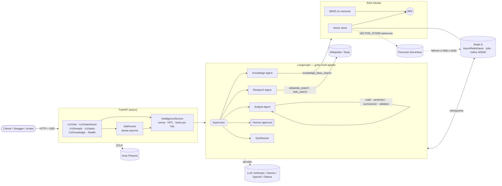
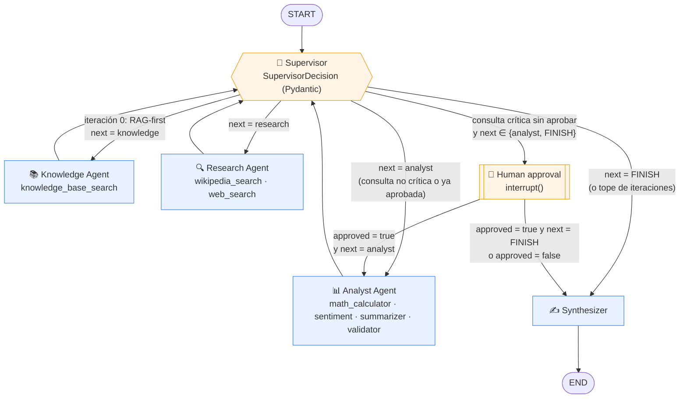
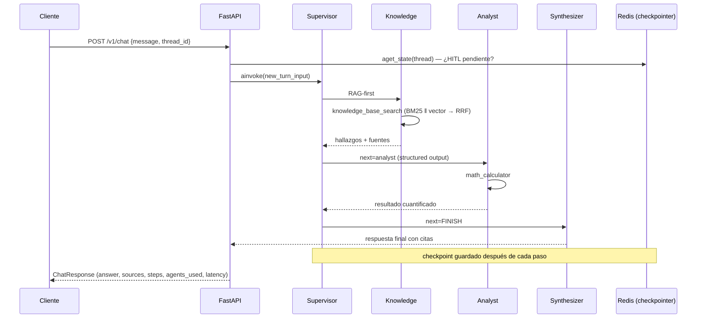
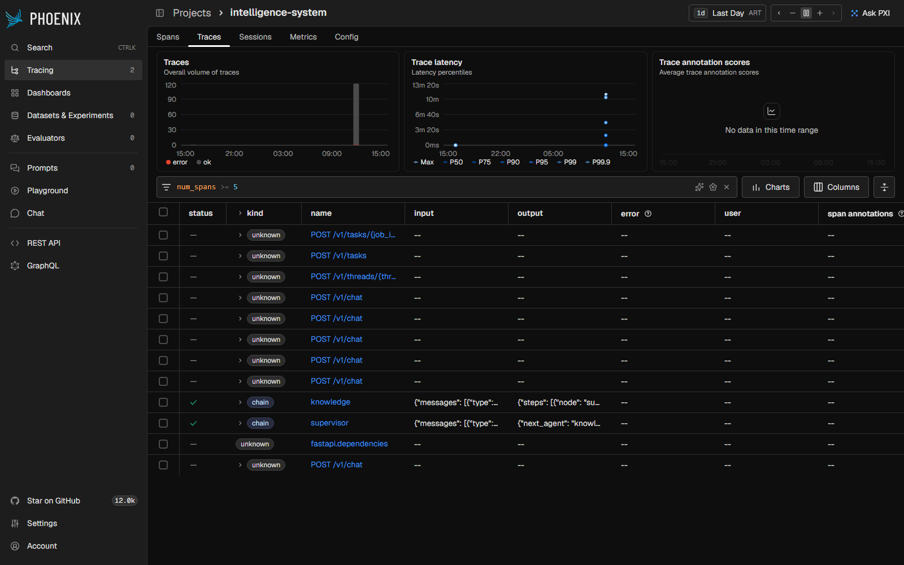
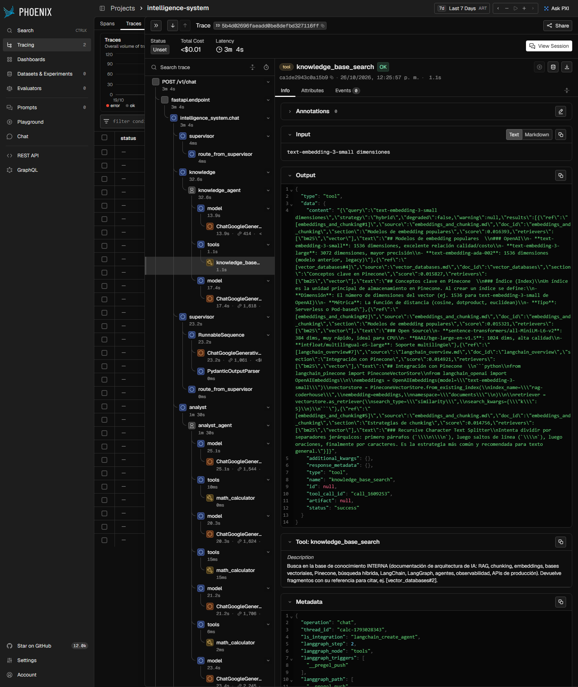
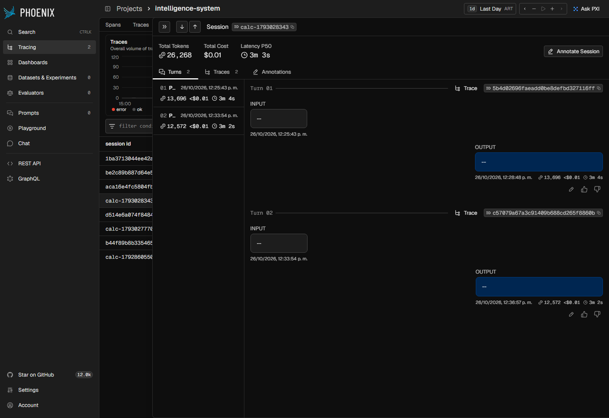

# Intelligence System — AI Architecture Advisor

Sistema de IA de grado producción que responde consultas técnicas complejas sobre arquitectura de sistemas de IA combinando **RAG híbrido** (BM25 + vectorial + RRF), **agentes coordinados por un Supervisor** (LangGraph), **Human-in-the-Loop**, una **API REST async documentada** (FastAPI) y **trazabilidad completa** en Arize Phoenix.

> Entrega final — CoderHouse · AI Engineering. Integra y refactoriza las pre-entregas de los módulos 4 (RAG con Pinecone), 6 (orquestador multi-agente) y 7 (API de producción y monitoreo).

```bash
./run.sh          # Linux / macOS / Git Bash
.\run.ps1         # Windows PowerShell
```

Un solo comando levanta **Redis 8 + Arize Phoenix + API**, ingesta la base de conocimiento y deja todo listo en `http://localhost:8000/docs`.

---

## Contenido

1. [Criterios de aceptación → dónde se cumplen](#1-criterios-de-aceptación--dónde-se-cumplen)
2. [Arquitectura](#2-arquitectura)
3. [Diagrama de flujo del grafo de agentes](#3-diagrama-de-flujo-del-grafo-de-agentes)
4. [Puesta en marcha](#4-puesta-en-marcha)
5. [Uso de la API](#5-uso-de-la-api)
6. [Persistencia (Checkpointer)](#6-persistencia-checkpointer)
7. [Observabilidad y pruebas del sistema](#7-observabilidad-y-pruebas-del-sistema)
8. [RAG: ingesta, recuperación y evaluación](#8-rag-ingesta-recuperación-y-evaluación)
9. [Validación con Pydantic](#9-validación-con-pydantic)
10. [Tests](#10-tests)
11. [Configuración](#11-configuración)
12. [Estructura del proyecto](#12-estructura-del-proyecto)
13. [Decisiones de diseño](#13-decisiones-de-diseño)

---

## 1. Criterios de aceptación → dónde se cumplen

| Criterio | Implementación |
|---|---|
| **Integración de código** (M6 + M7 en una estructura unificada) | Paquete único `app/`: `agents/` (Supervisor + agentes del M6), `api/` (FastAPI + jobs + HITL del M7), `rag/` (retriever híbrido del M4), `tools/`. |
| **Refactorización async** | Todo el camino LLM/DB es `async`: nodos del grafo (`ainvoke`), agentes ReAct, embeddings (`aembed_*`), Redis (`redis.asyncio`), checkpointer (`AsyncRedisSaver`), vector store (RedisVL `AsyncSearchIndex` / `PineconeAsyncio`), Wikipedia vía `httpx.AsyncClient`, Tavily vía `ainvoke`. Sin `requests` ni `run_in_threadpool`; el CPU puro (BM25, lectura de disco) va a `asyncio.to_thread`. |
| **Persistencia con Checkpointer** | `AsyncRedisSaver` (`app/api/main.py`). Cada conversación es un `thread_id`; las conversaciones **y las aprobaciones HITL pendientes** sobreviven a reinicios (probado en `tests/test_persistence.py` y en la [sección 6](#6-persistencia-checkpointer)). |
| **Validación con Pydantic** | Entradas/salidas de **todos** los endpoints (`app/api/schemas.py`), `args_schema` + modelo de salida de **cada** herramienta (`app/tools/schemas.py`), decisión estructurada del Supervisor (`SupervisorDecision`), payloads de HITL (`ApprovalRequest`/`ApprovalDecision`) y configuración (`pydantic-settings`). |
| **Observabilidad (≥ 5 pruebas con trazas)** | OpenInference → Arize Phoenix (`app/observability.py`), agrupado por sesión (`thread_id`). `scripts/run_scenarios.py` ejecuta **6 escenarios** end-to-end; resultados en `docs/evidence/`. |
| **README con diagrama del grafo** | [Sección 3](#3-diagrama-de-flujo-del-grafo-de-agentes) (Mermaid). |
| **Despliegue local con una instrucción** | `./run.sh` / `.\run.ps1` / `docker compose up --build`. |
| **Proveedores intercambiables** | LLM: Anthropic, Gemini, OpenAI u Ollama. Embeddings: Gemini, OpenAI u Ollama. Se eligen por `.env`; el índice se recrea solo si cambia el modelo de embeddings ([ver](#proveedores-de-llm-y-embeddings)). |
| **Sin hard-coding** | Modelos, índices de Pinecone/Redis, namespaces, URLs y pesos del retriever salen de variables de entorno (`app/config.py`, `.env.example`). |

---

## 2. Arquitectura



| Componente | Responsabilidad |
|---|---|
| **Supervisor** | Decide el próximo paso con salida estructurada (`SupervisorDecision`). Política *RAG-first*, tope de iteraciones, máximo 2 ejecuciones por agente y fallback por reglas si el LLM devuelve algo inválido. |
| **Knowledge Agent** | Agente ReAct con `knowledge_base_search` (RAG híbrido). Puede reformular y buscar varias veces; devuelve hallazgos citados (`[doc#n]`) y las fuentes al estado. |
| **Research Agent** | Agente ReAct con `wikipedia_search` (MediaWiki API async) y `web_search` (Tavily, opcional). |
| **Analyst Agent** | Agente ReAct con `math_calculator` (evaluador AST seguro), `sentiment_analyzer`, `text_summarizer`, `data_validator`. |
| **Human approval** | `interrupt()` de LangGraph para consultas con efectos colaterales (borrar, desplegar, ejecutar, pagar…). |
| **Synthesizer** | Redacta la respuesta final con citas, usando el historial de la conversación. |

---

## 3. Diagrama de flujo del grafo de agentes



**Reglas de routing** (`app/agents/supervisor.py`):

1. **RAG-first:** el primer paso de cada turno siempre consulta la base interna (sin gastar una llamada al LLM). Así toda respuesta queda anclada en documentos.
2. Después, el LLM del Supervisor elige `knowledge`, `research`, `analyst` o `FINISH` según lo que falte.
3. **Guardas duras:** `MAX_ITERATIONS` (por defecto 8) y como máximo 2 ejecuciones del mismo agente por turno. El grafo siempre termina.
4. **HITL:** si la consulta es crítica, el grafo se pausa antes de producir un resultado accionable (análisis o respuesta final). Si se rechaza, el Synthesizer informa el rechazo sin generar el plan.

**Estado del grafo** (`AgentState`): `messages` guarda solo la conversación visible (usuario ↔ asistente) y es lo que persiste entre turnos. El resto (`knowledge_context`, `sources`, `research_data`, `analysis_result`, `steps`, `iteration_count`, `is_critical`, `is_approved`…) es el espacio de trabajo del turno y se reinicia con cada mensaje.

Secuencia de un turno típico con cálculo:



---

## 4. Puesta en marcha

### Requisitos

- Docker + Docker Compose.
- Un proveedor de LLM y uno de embeddings (ver [Proveedores](#proveedores-de-llm-y-embeddings)):
  - **Ollama** (por defecto, local, sin costo): `ollama pull qwen2.5:7b && ollama pull nomic-embed-text`.
  - o **Anthropic**, **Gemini** u **OpenAI**: completar la clave en `.env`. Con Claude + embeddings de Gemini (o 100% Gemini) **no hace falta Ollama**.
- *(Opcional)* `TAVILY_API_KEY` para búsqueda web; `PINECONE_API_KEY` para usar Pinecone como vector store.

### Opción A — un solo comando (recomendada)

```bash
./run.sh            # crea .env si no existe, build + up, espera a /health
./run.sh logs       # logs de la API
./run.sh down       # detener (los datos quedan en volúmenes)
```

En Windows PowerShell: `.\run.ps1`, `.\run.ps1 logs`, `.\run.ps1 down`. Equivalente manual: `cp .env.example .env && docker compose up --build`.

Al arrancar, la API:
1. conecta el checkpointer `AsyncRedisSaver`,
2. carga y fragmenta `data/documents/` y construye el índice BM25,
3. **ingesta automáticamente** los embeddings en el vector store si el índice está vacío (`AUTO_INGEST=true`),
4. compila el grafo e instrumenta las trazas hacia Phoenix.

| Servicio | URL |
|---|---|
| API · Swagger | http://localhost:8000/docs |
| API · ReDoc | http://localhost:8000/redoc |
| Arize Phoenix | http://localhost:6006 |
| Redis | `localhost:6380` (puerto del host configurable con `REDIS_HOST_PORT`) |

### Opción B — API local sin Docker (desarrollo)

```bash
python -m venv .venv && source .venv/bin/activate      # Windows: .venv\Scripts\Activate.ps1
pip install -r requirements-dev.txt
docker compose up -d redis phoenix                       # dependencias
cp .env.example .env                                     # REDIS_URL=redis://localhost:6380
uvicorn app.api.main:app --reload
```

### Proveedores de LLM y embeddings

El sistema separa dos decisiones, ambas configurables solo por `.env` (sin tocar código):

| | `anthropic` | `gemini` | `openai` | `ollama` |
|---|---|---|---|---|
| **LLM** (`LLM_PROVIDER`) | ✅ `claude-sonnet-5-5` | ✅ `gemini-3.8-flash` | ✅ `gpt-4o-mini` | ✅ `qwen2.5:7b` |
| **Embeddings** (`EMBEDDING_PROVIDER`) | ❌ Anthropic no ofrece API de embeddings | ✅ `gemini-embedding-2` (768 dims) | ✅ `text-embedding-3-small` | ✅ `nomic-embed-text` |
| Salida estructurada del Supervisor | tool calling | JSON schema | tool calling | JSON schema |
| Clave | `ANTHROPIC_API_KEY` | `GOOGLE_API_KEY` | `OPENAI_API_KEY` | — |

Combinaciones recomendadas para **dejar de usar Ollama**:

```env
# Opción 1 — Claude como LLM + embeddings de Gemini
LLM_PROVIDER=anthropic
ANTHROPIC_API_KEY=sk-ant-...
EMBEDDING_PROVIDER=gemini
GOOGLE_API_KEY=...

# Opción 2 — 100% Gemini (una sola clave)
LLM_PROVIDER=gemini
EMBEDDING_PROVIDER=gemini
GOOGLE_API_KEY=...
```

Ambas funcionan igual con `./run.sh`: el aviso de Ollama solo aparece si algún proveedor sigue siendo `ollama`. Los nombres de modelo se cambian con `ANTHROPIC_MODEL`, `GEMINI_MODEL`, `GEMINI_EMBEDDING_MODEL`, etc. Para Gemini 3.x se usa `GEMINI_TEMPERATURE=1.0`, el valor que recomienda Google.

**Cambio de modelo de embeddings sin pasos manuales:** el índice guarda una huella del espacio vectorial (`proveedor:modelo:dimensión`), en Redis como metadato y en Pinecone como *tag* del índice. Al arrancar, si la huella no coincide con la configuración actual, la API **recrea el índice y reingesta sola** (en Pinecone elimina y recrea el índice si cambió la dimensión). También se puede forzar con `POST /v1/knowledge/ingest` o `python -m app.rag.ingest`.

> Con Ollama en CPU (sin GPU) cada llamada al LLM tarda 1–2 minutos y un turno completo puede llevar varios minutos. Con Claude o Gemini la latencia típica es de segundos.

**Pinecone** (pre-entrega M4) como vector store, combinable con cualquier proveedor. Con `VECTOR_STORE_FALLBACK=redis`, Redis actúa como **réplica de failover**:

```env
VECTOR_STORE=pinecone
VECTOR_STORE_FALLBACK=redis        # opcional
PINECONE_API_KEY=pc-...
PINECONE_INDEX_NAME=intelligence-kb
```

Cadena de recuperación: **Pinecone → Redis → BM25**. La ingesta escribe en ambos índices. Si Pinecone falla o no responde en `VECTOR_SEARCH_TIMEOUT_SECONDS`, la búsqueda vectorial se resuelve en Redis (`vector_backend: "redis"` en `/v1/knowledge/search`). Si ambos fallan, degrada a BM25 (`degraded: true`). Al arrancar, si la réplica está vacía o tiene otra huella de embeddings, se reingesta.

---

## 5. Uso de la API

Toda la API está documentada en Swagger (`/docs`) con esquemas y ejemplos. Ejemplos con `curl` (en PowerShell usá `curl.exe`):

**Conversación (multi-turno):**

```bash
curl -s localhost:8000/v1/chat -H "Content-Type: application/json" \
  -d '{"message": "¿Cuántas dimensiones tiene text-embedding-3-small? Calculá cuántos GB ocupan 2M de vectores en float32", "thread_id": "demo-1"}'

curl -s localhost:8000/v1/chat -H "Content-Type: application/json" \
  -d '{"message": "¿Y con un modelo de 768 dimensiones, cuánto ahorro?", "thread_id": "demo-1"}'
```

Respuesta (`ChatResponse`):

```json
{
  "thread_id": "demo-1",
  "status": "completed",
  "answer": "El modelo text-embedding-3-small genera vectores de 1536 dimensiones [embeddings_and_chunking#3] ... ≈ 11,44 GB ...",
  "sources": [{"ref": "[embeddings_and_chunking#3]", "source": "embeddings_and_chunking.md", "score": 0.0163, "retrievers": ["bm25", "vector"], "preview": "..."}],
  "agents_used": ["knowledge", "analyst"],
  "steps": [{"node": "supervisor", "decision": "knowledge", "summary": "política RAG-first..."}, "..."],
  "iterations": 3,
  "pending_approval": null,
  "latency_ms": 41250
}
```

**Streaming por nodo (SSE):**

```bash
curl -N localhost:8000/v1/chat/stream -H "Content-Type: application/json" -d '{"message": "¿Qué es RRF?"}'
# event: start / event: step (uno por nodo) / event: final
```

**Historial persistido de un hilo:** `curl -s localhost:8000/v1/threads/demo-1`

**Human-in-the-Loop:**

```bash
curl -s localhost:8000/v1/chat -H "Content-Type: application/json" \
  -d '{"message": "Borrar el índice de producción y reingestar todo", "thread_id": "ops-1"}'
# → "status": "awaiting_approval", "pending_approval": {"reason": ..., "planned_action": "analyst", ...}

curl -s localhost:8000/v1/threads/ops-1/approve -H "Content-Type: application/json" \
  -d '{"approved": true, "comment": "Ejecutar fuera del horario pico"}'
# → "status": "completed"   (con {"approved": false} → "status": "rejected")
```

**Tareas en background:**

```bash
curl -s localhost:8000/v1/tasks -H "Content-Type: application/json" -d '{"message": "..."}'   # 202 + job_id
curl -s localhost:8000/v1/tasks/<job_id>                                                     # polling
curl -s localhost:8000/v1/tasks/<job_id>/approve -H "Content-Type: application/json" -d '{"approved": false}'
```

**RAG directo y re-ingesta:** `POST /v1/knowledge/search {"query": "...", "k": 5}` · `POST /v1/knowledge/ingest`

| Código | Cuándo |
|---|---|
| 200 / 202 | OK / tarea encolada |
| 404 | hilo o tarea inexistente |
| 409 | hilo ocupado, HITL pendiente al enviar un mensaje, o aprobación sin HITL pendiente |
| 422 | validación Pydantic (mensaje vacío, `thread_id` inválido, `k` fuera de rango…) |
| 503 | Redis no disponible para tareas en background |

Todas las respuestas llevan `x-request-id` y los errores siguen el esquema `ErrorResponse`.

---

## 6. Persistencia (Checkpointer)

`AsyncRedisSaver` guarda un checkpoint del estado después de cada paso del grafo, indexado por `thread_id`. Como el estado no vive en memoria del proceso:

- una conversación puede continuarse después de reiniciar la API,
- una aprobación HITL pendiente puede resolverse después de un reinicio,
- `GET /v1/threads/{id}` reconstruye el historial directamente desde Redis.

**Prueba manual:**

```bash
curl -s localhost:8000/v1/chat -H "Content-Type: application/json" -d '{"message": "¿Qué es BM25?", "thread_id": "persist-1"}'
docker compose restart api          # reinicio del servidor
curl -s localhost:8000/v1/threads/persist-1        # el historial sigue ahí
curl -s localhost:8000/v1/chat -H "Content-Type: application/json" -d '{"message": "¿Y cómo se combina con la búsqueda vectorial?", "thread_id": "persist-1"}'
```

Resultado de esta prueba con el sistema en Docker: [`docs/evidence/restart_persistence.md`](docs/evidence/restart_persistence.md).

**Prueba automatizada:** `tests/test_persistence.py` cierra el checkpointer y el grafo, crea unos nuevos (simulando el reinicio) y verifica que el historial y el HITL pendiente se recuperan y continúan.

Redis corre con AOF (`--appendonly yes`) y volumen `redis_data`, así los datos también sobreviven a `docker compose down`/`up`. Para que los hilos expiren, configurar `CHECKPOINT_TTL_MINUTES`.

---

## 7. Observabilidad y pruebas del sistema

Cada request genera una traza en Phoenix con el árbol completo: grafo → nodo → agente → LLM (prompt, respuesta, tokens, latencia) → tool (argumentos y salida validada). Las trazas se agrupan por **sesión** (`session.id = thread_id`), así un hilo multi-turno se ve completo en la pestaña *Sessions*. Además, la API registra cada request con su `x-request-id` y latencia, y cada decisión del Supervisor.

```bash
python scripts/run_scenarios.py        # con la API levantada
```

| # | Escenario | Qué demuestra |
|---|---|---|
| 1 | RAG puro | Knowledge Agent + citas `[doc#n]` |
| 2 | RAG + cálculo | Knowledge → Analyst (`math_calculator`) |
| 3 | Investigación externa + RAG | Research (Wikipedia async) + base interna |
| 4 | Memoria multi-turno | Pregunta de seguimiento sobre el hilo del escenario 2 |
| 5 | HITL aprobado | `awaiting_approval` → `approve` → `completed` |
| 6 | HITL rechazado vía `/v1/tasks` | Tarea en background → `reject` → `rejected` |

Los resultados se guardan en [`docs/evidence/scenarios_report.md`](docs/evidence/scenarios_report.md) (recorrido del grafo y respuesta de cada escenario) y `scenarios_results.json`.

**Última corrida** (2026-10-26) · LLM `gemini-3.5-flash-lite` · embeddings `nomic-embed-text` (Ollama) · vector store Pinecone con failover a Redis:

| Escenario | Estado | Agentes | Iteraciones | Fuentes | Latencia | Verificación |
|---|---|---|---|---|---|---|
| 1. RAG puro | completed | knowledge | 2 | 5 | 89 s | Explica RRF con citas `[hybrid_search#6]` |
| 2. RAG + cálculo | completed | knowledge, analyst | 3 | 5 | 184 s | 1536 dims (de la KB) → 12,29 GB / 11,44 GiB ✔ |
| 3. Investigación externa + RAG | completed | knowledge, research | 3 | 6 | 307 s | Robertson y Spärck Jones, sistema Okapi (City University London) ✔ |
| 4. Memoria multi-turno | completed | knowledge, analyst | 3 | 5 | 183 s | Resuelve "¿y si usara 768?" con el contexto del turno anterior → 50 % de ahorro ✔ |
| 5. HITL aprobado | completed | knowledge, analyst | 3 | 10 | 247 s | Pausa en `awaiting_approval`, se aprueba y estima 1.875 chunks ✔ |
| 6. HITL rechazado (`/v1/tasks`) | rejected | knowledge, research | 3 | 8 | 207 s | Tarea en background → rechazo → no se genera el plan ✔ |

> La latencia incluye las llamadas al plan gratuito de Gemini (con reintentos ante 503) y los embeddings en CPU. En los escenarios 2 y 4 el Supervisor envió al Analyst por la **regla de cobertura** (la consulta pide un cálculo explícito); en el 3 el propio LLM decidió ir a Research.

**Capturas de Phoenix** (generadas con `python scripts/capture_phoenix.py`, Playwright):

| Trazas de la API (filtro `num_spans >= 5`, sin el polling de tareas) |
|---|
|  |

| Detalle de una traza (escenario 2): `supervisor → knowledge_agent → knowledge_base_search → supervisor → analyst_agent → math_calculator → …` |
|---|
|  |

| Sesión multi-turno (escenarios 2 y 4) agrupada por `thread_id` |
|---|
|  |

**Alternativa LangSmith:** `PHOENIX_ENABLED=false`, `LANGSMITH_TRACING=true`, `LANGSMITH_API_KEY=...`.

---

## 8. RAG: ingesta, recuperación y evaluación

**Corpus** (`data/documents/`, 8 documentos): fundamentos de RAG, bases vectoriales y Pinecone, embeddings y chunking, búsqueda híbrida, LangChain, LangGraph y agentes, observabilidad, APIs de producción.

**Ingesta** (`app/rag/loader.py`, `knowledge_base.py`): split por encabezados Markdown → `RecursiveCharacterTextSplitter` (600/100) → metadatos (`doc_id`, `source`, `title`, `section`, `category`, `chunk_index`) → IDs **determinísticos** → embeddings async → upsert en el vector store.

**Recuperación híbrida:** BM25 (léxico, normaliza acentos y stopwords ES/EN) y búsqueda vectorial corren **en paralelo** (`asyncio.gather`), se toman `3·k` candidatos de cada lado y se fusionan con **Reciprocal Rank Fusion ponderado** (`0.4·BM25 + 0.6·vector`, `rrf_k=60`). Si el vector store cae, el sistema **degrada a BM25** y lo informa (`degraded: true`) en lugar de fallar.

**Vector stores intercambiables** (`VECTOR_STORE`): `redis` (por defecto, índice HNSW coseno en Redis 8 vía RedisVL), `pinecone` (Serverless, `PineconeAsyncio`), `memory` (tests).

**Evaluación** sobre el golden set (`data/golden_set.json`, 19 preguntas):

```bash
python scripts/evaluate_rag.py --k 5
```

Resultados (Redis + `nomic-embed-text`, 71 chunks) con ablación de estrategias:

| Estrategia | Hit Rate@5 | MRR | Precision@5 | Precision@3 |
|---|---|---|---|---|
| **Híbrida (0.4 BM25 + 0.6 vector, RRF)** | **1.00** | **1.00** | **0.80** | **0.93** |
| Solo BM25 | 1.00 | 0.97 | 0.65 | 0.75 |
| Solo vectorial | 1.00 | 1.00 | 0.83 | 0.96 |

*Precision@k = fracción de los k chunks recuperados que pertenecen al documento esperado.*

**Lectura honesta:** en este corpus chico y bien estructurado los embeddings ya rinden muy bien, y la híbrida queda apenas por debajo de la vectorial pura en precisión (−0.03), pero muy por encima de BM25 (+0.15). Se mantiene la híbrida porque (1) BM25 aporta coincidencia exacta de términos raros (nombres de modelos, siglas, parámetros como `rrf_k`) que los embeddings suelen diluir en corpus grandes, y (2) da tolerancia a fallos: si el vector store no responde, el sistema sigue funcionando con BM25. Los pesos son configurables (`BM25_WEIGHT`/`VECTOR_WEIGHT`) para ajustarlos con un golden set más grande.

Detalle por pregunta en [`docs/evidence/rag_evaluation.json`](docs/evidence/rag_evaluation.json).

---

## 9. Validación con Pydantic

| Capa | Modelos |
|---|---|
| API (entrada) | `ChatRequest` (longitud, patrón de `thread_id`), `ApprovalBody`, `KnowledgeQuery` (`k` 1–20) |
| API (salida) | `ChatResponse`, `ThreadState`, `JobRecord`, `TaskAccepted`, `HealthResponse`, `IngestResponse`, `ErrorResponse` |
| Herramientas (entrada, `args_schema`) | `KnowledgeSearchInput`, `WebSearchInput`, `WikipediaSearchInput`, `CalculatorInput`, `SentimentInput`, `SummarizerInput`, `DataValidatorInput` |
| Herramientas (salida) | `KnowledgeSearchOutput`, `WebSearchOutput`, `WikipediaOutput`, `CalculatorOutput`, `SentimentOutput`, `SummarizerOutput`, `DataValidatorOutput` |
| Agentes | `SupervisorDecision` (salida estructurada del LLM), `ApprovalRequest` / `ApprovalDecision` (HITL), `StepRecord` |
| RAG | `Chunk`, `RetrievedChunk`, `RetrievalResult`, `IngestReport` |
| Configuración | `Settings` (`pydantic-settings`, con validaciones cruzadas) |

Si el LLM genera argumentos inválidos para una herramienta, el `ToolNode` devuelve el error de validación al agente para que se corrija, en lugar de ejecutar la herramienta con datos incorrectos.

---

## 10. Tests

```bash
pip install -r requirements-dev.txt
pytest
```

65 tests, sin LLM real (usan `ScriptedChatModel`, un chat model determinístico con soporte de tools y salida estructurada):

| Archivo | Cobertura |
|---|---|
| `test_tools.py` | Herramientas, validación de argumentos con Pydantic, salidas tipadas |
| `test_rag.py` | Chunking determinístico, tokenización, RRF, búsqueda híbrida, degradación a BM25, idempotencia de ingesta |
| `test_graph.py` | Recorrido completo del grafo, fallback del Supervisor, guarda de iteraciones, memoria multi-turno, HITL aprobado/rechazado |
| `test_api.py` | Endpoints, validación 422, historial de hilos, HITL vía API (409), tareas en background, SSE, búsqueda RAG |
| `test_persistence.py` | **Reinicio simulado con Redis real**: historial y HITL pendiente sobreviven (se omite si no hay Redis) |
| `test_vector_fallback.py` | Failover Pinecone → réplica (error y timeout), ingesta en ambos backends, reingesta si la réplica diverge, validación de config |
| `test_providers.py` | Factories de Anthropic/Gemini/OpenAI/Ollama, claves faltantes, método de salida estructurada, reingesta automática al cambiar de modelo de embeddings |
| `test_redis_vectorstore.py` | Round-trip contra Redis 8: índice HNSW, IDs de chunk y scores coseno (se omite si no hay Redis) |

---

## 11. Configuración

Todas las variables están documentadas en [`.env.example`](.env.example). Las principales:

| Variable | Default | Descripción |
|---|---|---|
| `LLM_PROVIDER` | `ollama` | `anthropic` · `gemini` · `openai` · `ollama` |
| `ANTHROPIC_MODEL` / `GEMINI_MODEL` / `OPENAI_MODEL` / `OLLAMA_MODEL` | `claude-sonnet-5-5` / `gemini-3.8-flash` / `gpt-4o-mini` / `qwen2.5:7b` | Modelo de chat |
| `ANTHROPIC_API_KEY` / `GOOGLE_API_KEY` / `OPENAI_API_KEY` | vacío | Claves de los proveedores cloud |
| `EMBEDDING_PROVIDER` | `ollama` | `ollama` (`nomic-embed-text`) · `gemini` (`gemini-embedding-2`) · `openai` (`text-embedding-3-small`) |
| `GEMINI_EMBEDDING_DIMENSIONS` | `768` | Dimensión de salida de Gemini (128–3072) |
| `LLM_TIMEOUT_SECONDS` | vacío | Timeout por llamada al LLM (vacío = 600 s con Ollama, 120 s con APIs cloud) |
| `VECTOR_STORE` | `redis` | `redis` · `pinecone` · `memory` |
| `VECTOR_STORE_FALLBACK` | — | Réplica de failover (p. ej. `redis` con `VECTOR_STORE=pinecone`) |
| `VECTOR_SEARCH_TIMEOUT_SECONDS` | `5` | Tiempo máximo del principal antes de consultar la réplica |
| `REDIS_INDEX_NAME` / `PINECONE_INDEX_NAME` / `PINECONE_NAMESPACE` | `intelligence-kb` / `intelligence-kb` / `documents` | Índices |
| `RETRIEVAL_TOP_K`, `BM25_WEIGHT`, `VECTOR_WEIGHT`, `RRF_K` | `5`, `0.4`, `0.6`, `60` | Recuperación híbrida |
| `CHUNK_SIZE`, `CHUNK_OVERLAP` | `600`, `100` | Chunking |
| `REDIS_URL` | `redis://localhost:6380` | Checkpointer + jobs + vector store |
| `CHECKPOINT_TTL_MINUTES` | vacío | Expiración de hilos (vacío = nunca) |
| `MAX_ITERATIONS`, `RAG_FIRST`, `HISTORY_WINDOW` | `8`, `true`, `6` | Orquestación |
| `TAVILY_API_KEY` | vacío | Búsqueda web (sin clave: solo Wikipedia) |
| `PHOENIX_ENABLED`, `PHOENIX_COLLECTOR_ENDPOINT`, `PHOENIX_PROJECT_NAME` | `true`, `http://localhost:6006`, `intelligence-system` | Trazas |

---

## 12. Estructura del proyecto

```
├── app/
│   ├── config.py              # Settings (pydantic-settings): toda la configuración
│   ├── llm.py                 # Factories de chat/embeddings: Anthropic · Gemini · OpenAI · Ollama
│   ├── observability.py       # Logging + Phoenix/OpenInference + sesiones
│   ├── service.py             # Turnos de conversación, HITL, streaming, estado de hilos
│   ├── agents/
│   │   ├── graph.py           # StateGraph: nodos y aristas
│   │   ├── state.py           # AgentState, SupervisorDecision, StepRecord
│   │   ├── supervisor.py      # Supervisor + routing + detección de consultas críticas
│   │   ├── workers.py         # Knowledge / Research / Analyst (create_agent)
│   │   ├── hitl.py            # interrupt() + ApprovalRequest/Decision
│   │   ├── synthesizer.py     # Respuesta final
│   │   └── prompts.py
│   ├── rag/
│   │   ├── loader.py          # Carga + chunking determinístico
│   │   ├── vectorstore.py     # Redis (RedisVL) · Pinecone (async) · memoria · failover
│   │   ├── knowledge_base.py  # BM25 + vector + RRF, ingesta, degradación
│   │   ├── models.py
│   │   └── ingest.py          # CLI: python -m app.rag.ingest
│   ├── tools/
│   │   ├── schemas.py         # Contratos Pydantic de entrada/salida
│   │   ├── knowledge.py       # knowledge_base_search
│   │   ├── research.py        # wikipedia_search (httpx) · web_search (Tavily)
│   │   └── analysis.py        # math · sentiment · summarizer · validator
│   └── api/
│       ├── main.py            # FastAPI: lifespan, endpoints, errores, middleware
│       ├── schemas.py         # Contratos Pydantic de la API
│       └── jobs.py            # Tareas en background con estado en Redis
├── data/
│   ├── documents/             # Base de conocimiento (8 documentos)
│   └── golden_set.json        # 19 preguntas para evaluar el retriever
├── scripts/
│   ├── run_scenarios.py       # 6 pruebas end-to-end → trazas en Phoenix
│   └── evaluate_rag.py        # Hit Rate, MRR, Precision@k
├── tests/                     # 65 tests (pytest-asyncio)
├── docs/evidence/             # Resultados de escenarios y evaluación RAG
├── docs/screenshots/          # Capturas de Phoenix
├── docker-compose.yml         # Redis 8 + Phoenix + API
├── Dockerfile
├── run.sh · run.ps1           # Despliegue con una sola instrucción
├── requirements.txt · requirements-dev.txt
└── .env.example
```

---

## 13. Decisiones de diseño

| Decisión | Motivo |
|---|---|
| **Supervisor + agentes ReAct especializados** | Cada agente tiene 1–4 herramientas, lo que mejora la precisión del tool calling; el Supervisor centraliza la terminación. Los agentes se compilan una sola vez y sus mensajes internos no contaminan el historial del usuario. |
| **Política RAG-first** | Ancla cada respuesta en la base interna, ahorra una llamada al LLM por turno y evita que un modelo débil se saltee la KB (se observó con `qwen2.5:7b` en las primeras pruebas). Desactivable con `RAG_FIRST=false`. |
| **Salida estructurada + fallback por reglas + guardas duras** | Un LLM puede devolver JSON inválido o entrar en loops; el sistema siempre termina y siempre responde. |
| **Synthesizer separado** | La respuesta final se redacta una vez, con todo el contexto y el historial, y conserva las citas. |
| **HITL antes de resultados accionables** | En el M7 solo se interceptaba al Analyst; ahora también se intercepta el FINISH, así ninguna consulta crítica obtiene un plan sin aprobación. |
| **Redis como columna vertebral** | Un único servicio para checkpointer, tareas y vector store simplifica el despliegue local. Pinecone queda como opción cloud. |
| **Pinecone principal + Redis réplica** | Una búsqueda kNN siempre devuelve top-k: "consultar uno y si no encuentra, el otro" solo tiene sentido ante **fallas**, no ante resultados vacíos. Por eso el failover se activa por error o timeout. Mantener la réplica en Redis cuesta una escritura extra por ingesta y evita que una caída de Pinecone degrade el RAG a solo BM25. |
| **IDs de chunk determinísticos** | Permiten fusionar BM25 (en memoria) y vector store (externo) por ID, y hacen la ingesta idempotente. |
| **Degradación elegante** | Sin vector store → BM25; sin Tavily → Wikipedia; sin Phoenix → la API arranca igual; sin Redis → `InMemorySaver` con un error explícito en el log y en `/health`. |
| **Tareas asyncio en lugar de threadpool** | En el M7 el grafo era síncrono y corría en `run_in_threadpool`; ahora es async de punta a punta y corre en el event loop. |
| **Lock por hilo** | Evita dos turnos simultáneos sobre la misma conversación (409). Es por proceso: para varios workers se reemplazaría por un lock distribuido en Redis. |

### Origen de cada parte

| Pre-entrega | Qué se reutilizó | Qué se refactorizó |
|---|---|---|
| M4 — RAG con Pinecone | Corpus, golden set, BM25 + vector + RRF, metadatos | Async (`PineconeAsyncio`), RRF propio con IDs determinísticos, Redis como backend local, degradación a BM25 |
| M6 — Orquestador multi-agente | Supervisor, Research/Analyst, herramientas de análisis | Nodos async, `create_agent`, contratos Pydantic en las tools, Knowledge Agent y Synthesizer nuevos |
| M7 — API de producción | FastAPI, jobs en Redis, HITL con `interrupt()`, Phoenix | `AsyncRedisSaver`, `redis.asyncio`, conversaciones multi-turno, SSE, sesiones en Phoenix, manejo de errores |
